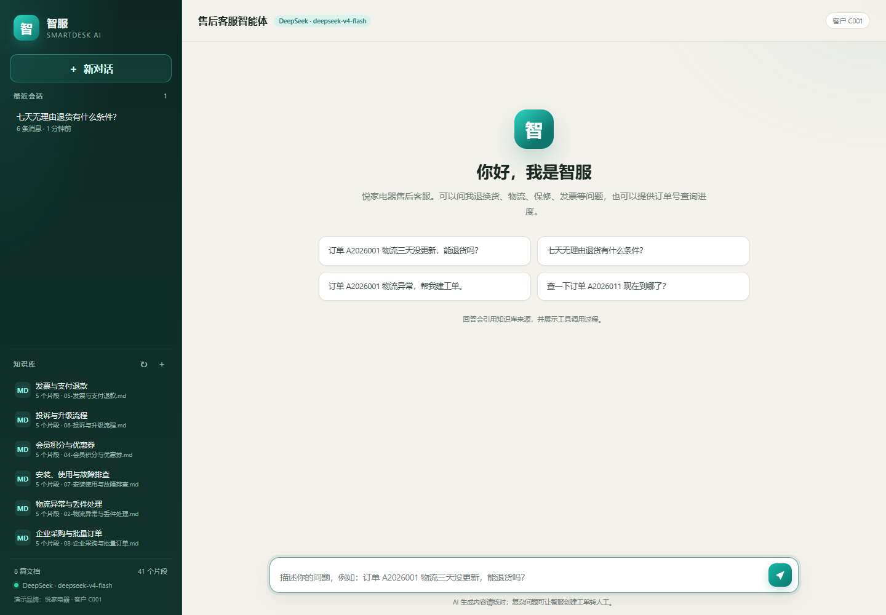
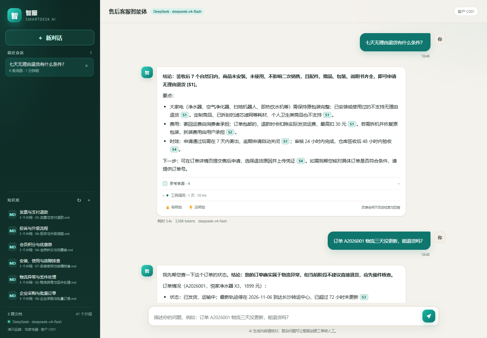
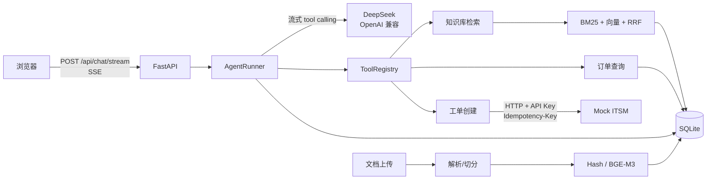

# 智服 SmartDesk AI

[](https://github.com/ddd0827/Smartdesk-ai/actions/workflows/ci.yml)

**面向售后客服场景的企业知识库智能体**：RAG 检索 + 工具调用 + 流式回答 + 引用溯源 + 工具轨迹 + 可复现评估。



> 演示品牌「悦家电器」、订单和售后政策均为虚构数据，仅用于项目展示。

## 这个项目解决什么

售后客服不是“陪聊”，而是要同时处理三类任务：

1. **政策/流程问答**：退换货、物流、保修、发票、会员——必须依据企业知识库回答，并给出处。
2. **订单查询**：用户报订单号，必须查客户系统，不能编造物流状态。
3. **升级人工**：确认订单归属后创建工单，调用客户现有 ITSM/CRM，且不能重复建单。

SmartDesk 用一个带工具的 Agent 把这三类任务串起来，并把检索来源、工具参数、耗时、token 用量持久化，方便演示、调试和审计。

## 亮点

- **完整可演示闭环**：问政策 → 查订单 → 建工单 → 越权拒绝；默认 Mock 模式无需 API Key。
- **混合检索**：中文分块 + BM25 + 字符 n-gram 哈希向量 + RRF；可选 BGE-M3 远程 embedding。
- **流式工具调用**：自研 httpx OpenAI 兼容客户端，按 `index` 拼装工具参数，处理 DeepSeek thinking 兼容与 429/5xx 重试。
- **工具安全**：白名单、Pydantic 参数校验、30s 超时、结果截断、会话内订单归属校验、工单幂等键、每会话上限。
- **可观测**：SSE 事件（token / trace / sources / done）、工具轨迹、引用快照、token/耗时、反馈统计。
- **可评估**：20 题冻结评估集，答案片段级 Recall/MRR，报告如实记录小样本与词法向量局限。
- **可交付**：58 个 pytest、Ruff、Dockerfile/Compose、GitHub Actions 真实构建镜像、Nginx SSE 反代、云主机部署与回滚文档。

## 快速开始（离线 Mock，无需 API Key）

要求：Python 3.11+。

```bash
python -m venv .venv

# Windows (Git Bash)
.venv/Scripts/pip install -r requirements-dev.txt
.venv/Scripts/python scripts/seed.py
.venv/Scripts/python -m uvicorn app.main:app --host 127.0.0.1 --port 8000

# macOS / Linux
# source .venv/bin/activate && pip install -r requirements-dev.txt
# python scripts/seed.py
# python -m uvicorn app.main:app --host 127.0.0.1 --port 8000
```

打开 <http://127.0.0.1:8000>。

- 没有 `.env` 时，`Settings` 默认 `LLM_PROVIDER=mock`，页面显示「离线演示」。
- 首次启动会自动导入 `seed/docs` 的 8 篇文档和 12 条订单；也可以手动运行 `scripts/seed.py`。
- **不要**把 `.env.example` 原样复制后直接启动：里面有占位 Key，程序会 fail-fast 提示你填写；这是故意的，避免拿假 Key 调模型。

## 接入 DeepSeek

DeepSeek 提供 OpenAI 兼容的 Chat Completions 接口，但**不提供 embedding 接口**，所以本项目默认用离线哈希向量，语义向量另配（见下一节）。

```bash
cp .env.example .env
# 编辑 .env：
# LLM_PROVIDER=deepseek
# LLM_API_KEY=sk-你的Key
# LLM_BASE_URL=https://api.deepseek.com
# LLM_MODEL=deepseek-v4-flash
# LLM_THINKING=disabled

python scripts/smoke.py          # 真实调用一次，确认 Key / 模型名 / 网络
python -m uvicorn app.main:app --host 127.0.0.1 --port 8000
```

说明：

- 旧 `deepseek-chat` / `deepseek-reasoner` 已于 2026-07-24 停用；当前使用 `deepseek-v4-flash`（或 `deepseek-v4-pro`）。
- 工具调用场景下 thinking 会被强制关闭，因为 V4 thinking 模式要求回传 `reasoning_content`，本项目的轻量循环不处理该字段。
- 如果服务端不接受 `thinking` / `stream_options`，客户端会自动去掉该字段重试一次；仍失败会给出可读错误。
- 本仓库不附带任何 API Key。项目开发时已用真实 Key 完成 smoke、SSE 多轮对话与工单联调（`deepseek-v4-flash`）；复现仍需你自备 Key 并用 `scripts/smoke.py` 验证。

### 可选：BGE-M3 语义 embedding

```dotenv
EMBEDDING_PROVIDER=openai_compatible
EMBEDDING_BASE_URL=https://api.siliconflow.cn/v1
EMBEDDING_API_KEY=sk-你的SiliconFlow-Key
EMBEDDING_MODEL=BAAI/bge-m3
```

重启服务后重建索引：

```bash
curl -X POST http://127.0.0.1:8000/api/documents/reindex \
  -H "X-Admin-Token: 你的令牌"     # ADMIN_TOKEN 为空则不需要该请求头
```

再运行 `python scripts/eval.py`，报告会显示新的 embedding 签名。切换 embedding 而不重建索引时，检索会跳过旧向量并在日志/统计中提示。

## 推荐演示

- 订单 A2026001 物流三天没更新，能退货吗？
- 七天无理由退货有什么条件？
- 订单 A2026001 物流异常，帮我建工单。
- 查一下订单 A2026011 现在到哪了？ → 越权被拒（A2026011 属于 C002）
- 发票多久能开出来？
- 退款一般多久到账？

完整 5 分钟流程见 [docs/demo-script.md](docs/demo-script.md)。



## 架构



关键取舍、失败处理与生产化路线见 [docs/architecture.md](docs/architecture.md)。

## 检索评估（真实运行结果）

评估脚本使用**临时数据库**重新导入种子文档，不依赖运行中的服务；题目在运行前冻结。

```bash
python scripts/eval.py
```

当前语料：8 篇演示文档、41 个分块；20 题。指标是**答案片段命中**——只有检索到的单个分块同时包含该题全部关键词才算命中。完整报告：[docs/eval-report.md](docs/eval-report.md)。

| 方法 | 答案 Recall@3 | 答案 Top-1 | MRR@10 | 文档 Recall@3 | 中位耗时 |
|---|---:|---:|---:|---:|---:|
| BM25-only | 0.900 | 0.800 | 0.865 | 0.950 | 0.12 ms |
| HashNgramVectorizer-only | 0.950 | 0.750 | 0.833 | 1.000 | 0.08 ms |
| Hybrid (RRF) | 0.900 | 0.800 | 0.864 | 1.000 | 0.29 ms |

混合检索相对 BM25：**胜 2 / 平 17 / 负 1**。

**不要把这张表当成语义检索效果**：

- `HashNgramVectorizer` 是固定种子的字符 n-gram 哈希词法向量，不是语义模型；
- 8 篇语料、20 道自标注题，只做方向性参考，不做显著性结论；
- 真实语义效果需要配置 BGE-M3 后重跑；
- 真实回答的引用正确率/拒答行为需真实 LLM 后人工抽查（清单见演示脚本）。
- 已知失败案例：q16 混合检索把 BM25 的第 2 名拉到第 5 名；q01 BM25 第 6、向量第 2、混合第 3。RRF 不是万能的，后续可以加 query rewrite / reranker。

## 测试

```bash
python -m pytest -q        # 58 passed（本机 Windows + Python 3.11.8）
ruff check app tests scripts
```

CI（GitHub Actions）：[`.github/workflows/ci.yml`](.github/workflows/ci.yml) 在 push/PR 时运行
pytest + Ruff + JS 语法检查，并 **真正 `docker build`**，启动容器验证 `/api/health`、
8 篇种子文档与 SSE 聊天。2026-11-10 已通过，运行记录见仓库 Actions 页面。

覆盖：

- 配置校验、SecretStr、占位 Key、生产 ADMIN_TOKEN；
- SQLite 事务与级联删除、会话/消息/反馈/工单；
- 中文切分、GBK、PDF 页数限制；
- BM25 / 哈希向量 / 混合检索 / 索引失效；
- 流式 delta 拼装、thinking 兼容重试、429/5xx 重试、错误映射；
- 工具参数校验、越权、ITSM 鉴权/超时/幂等/上限；
- Agent 工具循环、最大步数、错误持久化、非法引用、取消时保存部分回答；
- API/SSE 事件顺序、上传鉴权与大小/类型限制、反馈、Mock ITSM。

### 真实 DeepSeek 联调记录（2026-11-10）

- `scripts/smoke.py`：1.37 s 返回，模型 `deepseek-v4-flash`。
- 真实多轮 RAG：政策问题 → 订单问题 → 创建工单，工具轨迹与引用均正常；工单 `T46696E712F` 创建成功。
- 联调中发现：第二轮只查了订单、复用了上一轮政策记忆并写出无效 `[S1]`。服务端正确标记 `invalid_citations`；随后在系统提示中强制“每轮政策问题必须重新检索、禁止引用历史轮次 S 编号”，复测通过。这个案例也写进了面试问答。

## API 一览

| 方法 | 路径 | 说明 |
|---|---|---|
| POST | `/api/chat/stream` | SSE 对话：`session` / `token` / `trace` / `sources` / `done` / `error` |
| GET | `/api/sessions` | 会话列表 |
| GET | `/api/sessions/{id}/messages` | 会话消息（含工具轨迹、来源、反馈） |
| DELETE | `/api/sessions/{id}` | 删除会话 |
| POST | `/api/documents` | 上传文档（需 `X-Admin-Token`，若配置） |
| GET | `/api/documents` | 文档列表 |
| DELETE | `/api/documents/{id}` | 删除文档（管理员） |
| POST | `/api/documents/reindex` | 重建索引（管理员） |
| POST | `/api/feedback` | 👍/👎 反馈 |
| GET | `/api/stats` | 文档/分块/会话/反馈/耗时统计 |
| GET | `/api/meta` | 模式、模型、演示客户、建议问题 |
| GET | `/api/health` | 健康检查 |
| POST | `/api/mock/itsm/tickets` | 模拟第三方工单系统（`X-API-Key` + `Idempotency-Key`） |

交互式文档：`/docs`。

## 目录结构

```text
app/
├── api/            路由（chat/sessions/documents/feedback/stats/mock_itsm/health/meta）
├── agent/          AgentRunner、提示词、事件
├── llm/            DeepSeek httpx 流式客户端、离线 FakeLLM
├── rag/            解析、切分、分词、BM25、向量、混合索引、入库
├── store/          aiosqlite、schema、Repository
├── tools/          工具基类/注册表、知识库/订单/工单
├── web/            原生 HTML/CSS/JS 单页界面
├── config.py       pydantic-settings
├── deps.py         依赖组装（无模块级单例）
└── main.py         create_app、生命周期、中间件
seed/               8 篇售后文档 + 12 条订单
scripts/            seed.py / eval.py / smoke.py
eval/               冻结评估集
tests/              58 个 pytest
docs/               架构、演示、部署、评估报告
deploy/nginx.conf   SSE 反代示例
```

## 配置

完整示例见 `.env.example`；最常用的：

| 变量 | 默认 | 说明 |
|---|---|---|
| `LLM_PROVIDER` | `mock`（无 .env 时） | `deepseek` 或 `mock` |
| `LLM_BASE_URL` | `https://api.deepseek.com` | OpenAI 兼容端点 |
| `LLM_API_KEY` | 空 | DeepSeek Key，绝不提交 |
| `LLM_MODEL` | `deepseek-v4-flash` | 模型名以控制台为准 |
| `LLM_THINKING` | `disabled` | 工具模式自动强制关闭 |
| `EMBEDDING_PROVIDER` | `hash` | `openai_compatible` 可接 BGE-M3 |
| `ADMIN_TOKEN` | 空 | 配置后上传/删除/重建需令牌 |
| `ACCESS_USERNAME` | `demo` | 公网演示的 Basic 用户名 |
| `ACCESS_PASSWORD` | 空 | 配置后全站弹 HTTP Basic 认证（`/api/health` 豁免） |
| `DATA_DIR` | `./data` | SQLite 与运行数据 |
| `AUTO_SEED` | `true` | 首次启动导入演示数据 |
| `DEMO_CUSTOMER_ID` | `C001` | 演示客户；生产从登录态取 |
| `ITSM_BASE_URL` | 空→本机 8000 | 工单系统地址，只能由管理员配置 |
| `ITSM_API_KEY` | `demo-itsm-key` | 调工单系统的 Key |
| `MAX_UPLOAD_MB` | 5 | 上传限制 |
| `MAX_AGENT_STEPS` | 6 | Agent 最大工具轮数 |
| `MAX_TICKETS_PER_SESSION` | 3 | 每会话工单上限 |

## Docker 与部署

```bash
cp .env.example .env     # 可保持 mock；填 Key 则接真实模型
docker compose up -d --build
curl http://127.0.0.1:8000/api/health
```

- 容器内固定 `--workers 1`（检索索引是进程内缓存）。
- Nginx 反代示例：[deploy/nginx.conf](deploy/nginx.conf)，核心是 `proxy_buffering off`。
- 云主机、TLS、备份、回滚、扩缩容：见 [docs/deployment.md](docs/deployment.md)。
- 本机没有安装 Docker；GitHub Actions 已真实执行 `docker build`，启动容器验证 `/api/health`、8 篇种子文档/41 个分块和 SSE（运行记录见仓库 Actions 页面）。

## 安全与生产化

已实现：

- API Key / ADMIN_TOKEN 用 `SecretStr`，日志不打印；`.env` 不入库、不提交。
- 公网演示可设置 `ACCESS_PASSWORD`，全站启用 HTTP Basic（`/api/health` 豁免）；临时隧道演示见 [deployment.md](docs/deployment.md)。
- 上传白名单（md/txt/pdf）、5 MB 限制、PDF 页数限制、文件名清洗。
- SQL 参数化；前端对模型输出使用 DOM `textContent` 渲染，不用 `innerHTML`。
- 工具白名单、Pydantic 校验、30s 超时、结果截断；订单查询做客户归属校验。
- 建工单需要本会话先查订单、每会话最多 3 张、`Idempotency-Key` 防重复。
- 检索文档和工具结果在系统提示中标记为不可信数据，忽略其中指令。
- 同源部署，不启用 CORS；Nginx 示例带基础安全头。

尚未实现（生产前必须补）：

- 登录/SSO、RBAC、多租户隔离；当前 `C001` 是演示客户。
- PII 脱敏、审计日志留存、限流（当前只有单进程信号量与会话锁）。
- 分布式向量库、Redis 会话锁、多副本一致性。
- 真实客户 ITSM 的契约测试、沙箱与 egress allowlist。
- 成本看板、告警、OpenTelemetry。

## 项目定位与许可

- 这是一个独立完成的售后客服智能体原型，代码、业务场景、测试和评估都围绕本项目需求实现。
- 本项目代码使用 MIT License，见 [LICENSE](LICENSE)。

## 文档

- [架构与关键取舍](docs/architecture.md)
- [5 分钟演示脚本](docs/demo-script.md)
- [部署指南](docs/deployment.md)
- [检索评估报告](docs/eval-report.md)

## 免责声明

本项目是个人作品集/学习项目，不是悦家电器真实系统；售后政策、订单、工单均为演示数据。真实部署前请由业务、法务、安全团队审核提示词、数据处理和第三方系统接入。
