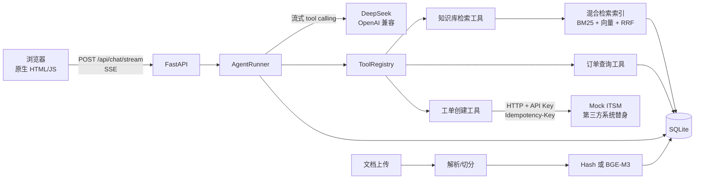

# SmartDesk AI 架构说明

## 1. 总览



一条消息的链路：

1. 浏览器 `fetch` 发送 POST，服务端返回 `text/event-stream`。
2. `AgentRunner` 读取最近历史，构造 system + user 消息。
3. 调用 DeepSeek 兼容接口，流式拼装 `tool_calls`。
4. 工具在服务端执行：查知识库、查订单、建工单；每个工具都有参数校验、超时和结果截断。
5. `TokenEvent`、`TraceEvent`、`SourcesEvent`、`DoneEvent` 实时推给前端。
6. 助手消息、工具轨迹、来源快照、token 用量、耗时一起写入 SQLite。

## 2. 目录与职责

```text
app/
├── main.py            FastAPI 工厂、生命周期、请求 ID、中间件、静态资源
├── config.py          pydantic-settings；SecretStr；启动校验
├── deps.py            组装 DB / 检索 / LLM / 工具 / Agent（无模块级单例）
├── llm/
│   ├── base.py        LLMEvent / ToolCall / LLMError 协议
│   ├── deepseek.py    httpx 流式客户端 + delta 拼装 + thinking 兼容
│   └── fake.py        离线规则模型（UI 演示 / 测试）
├── agent/
│   ├── runner.py      工具循环、引用校验、持久化、取消处理
│   ├── prompts.py     售后客服系统提示词（含注入防护）
│   └── events.py      AgentEvent 定义
├── tools/
│   ├── registry.py    白名单、Pydantic 校验、超时、截断
│   ├── kb.py          知识库检索工具
│   ├── orders.py      订单查询（客户归属）
│   └── tickets.py     工单创建（幂等、重试、上限）
├── rag/
│   ├── parsers.py     md/txt/pdf 解析与编码处理
│   ├── chunker.py     Markdown 分节 + 滑动窗口
│   ├── tokenizer.py   中文 uni/bi-gram + ASCII 词
│   ├── bm25.py        轻量 BM25
│   ├── vectors.py     HashNgramVectorizer / OpenAI 兼容 embedding
│   ├── index.py       懒加载混合索引 + RRF
│   └── ingest.py      入库、去重、删除、重建索引、种子数据
├── store/
│   ├── db.py          aiosqlite、WAL、短事务、写锁
│   ├── repo.py        领域查询
│   └── schema.sql     表结构
└── api/               chat / sessions / documents / feedback / stats / mock_itsm / health / meta
```

## 3. 数据模型

| 表 | 作用 | 关键点 |
|---|---|---|
| `documents` | 文档元数据与原文 | `content_hash` 去重；记录 embedding provider/model/dim |
| `chunks` | 分块与向量 BLOB | 主键 `doc_id#seq`，删除文档级联删除 |
| `sessions` | 会话 | 演示客户 `C001` |
| `messages` | 消息 | `meta_json` 存 trace、sources、usage、latency |
| `feedback` | 👍/👎 | 每个助手消息一条，可改评 |
| `orders` | 模拟客户订单库 | 带 `customer_id`，用于越权校验 |
| `session_orders` | 本会话查过的订单 | 建工单前置条件 |
| `tickets` | 工单 | `idempotency_key` 唯一 |
| `schema_meta` | 版本信息 | 预留迁移 |

## 4. 关键设计取舍

### 4.1 SSE 而不是 WebSocket

- 本项目是“用户发一条 → 服务端单向流式回答”，不需要双向通道。
- SSE 用普通 HTTP，Nginx 只要 `proxy_buffering off`；WebSocket 需要 Upgrade 配置。
- 代价：不能用 `EventSource`，前端必须用 `fetch` + `ReadableStream` 解析；我们已在 `app.js` 实现。
- 若未来需要人工坐席接管、多人协作，再升级到 WebSocket。

### 4.2 原始 httpx 而不是 OpenAI SDK

DeepSeek V4 的 `thinking`、`reasoning_content`、`stream_options` 在不同端点存在兼容差异。自己发原始 JSON 可以：

- 默认关闭 thinking（工具调用场景强制关闭）；
- 遇到“不认识 thinking / stream_options”的 400 时自动去掉字段重试一次；
- 按 `tool_calls[].index` 拼装参数，而不是依赖 SDK 类型；
- 统一把 401/402/404/429/5xx 映射成可读中文错误。

### 4.3 aiosqlite + WAL，而不是 Postgres

- 演示规模（几十~几百分块、单进程）足够；
- 部署简单，一个文件即可备份；
- 关键纪律：**写事务里不 await LLM/HTTP**；写操作用一个 `asyncio.Lock` 串行化；WAL + `busy_timeout` 保证并发读。
- 生产升级：Postgres + pgvector / Qdrant；会话锁改 Redis；文件存储改对象存储。

### 4.4 懒加载内存索引

`RetrievalIndex` 在首次检索时从 SQLite 读取分块，构建：

- BM25（中文 uni/bi-gram）；
- 归一化向量矩阵；
- RRF 融合。

文档变更后 `invalidate()`，下次检索重建。优点：简单、零外部依赖；限制：多 worker 时每个进程各有一份，因此 Docker 命令固定 `--workers 1`。生产多副本应使用共享向量库。

### 4.5 HashNgramVectorizer 的定位

`HashNgramVectorizer` 是固定种子 `blake2b` 的字符 n-gram 特征哈希，**词法向量，不是语义模型**。

- 目的：无额外 Key、离线跑通完整 RAG 管线和测试；
- 生产：切换 SiliconFlow `BAAI/bge-m3`（1024 维，OpenAI 兼容），然后重建索引；
- 评估报告明确区分“词法级管线验证”和“语义检索效果”，不夸大。

### 4.6 工具与会话状态

- 工具只暴露三个：检索、查订单、建工单；白名单在 `ToolRegistry`。
- `lookup_order` 只返回当前客户 `C001` 的订单；查不到与无权查看统一措辞，减少订单号枚举。
- 建工单必须：本会话查过该订单 → 未超过 3 张 → 带幂等键 POST 第三方系统。
- 工具结果截断到 4000 字符，避免把大段原文塞进上下文。
- 检索内容在提示词里明确标记为不可信数据，忽略其中指令。

### 4.7 引用与审计

- 知识库工具给每个分块分配 `S1..Sn`；
- 系统提示要求回答使用 `[S1]`，并且**每一轮政策问题都必须重新检索**，禁止引用历史轮次编号；
- 历史消息送入模型前会移除旧的 `[Sx]`，避免旧来源编号污染本轮；
- 只把本轮实际检索到的分块持久化到 `meta.sources`；
- `AgentRunner` 用正则校验引用编号，非法引用记录在 `meta.invalid_citations`，前端标记；
- 工具轨迹（参数、结果摘要、耗时）一并持久化，刷新页面仍可审计。

真实联调时确实出现过“第二轮复用上一轮政策、写出无效 `[S1]`”的情况：服务端校验把它标出来，随后通过提示词规则 9/10 加固并复测通过。这说明引用校验必须有兜底，不能只依赖模型自觉。

## 5. 失败处理

| 场景 | 行为 |
|---|---|
| DeepSeek 429/5xx | 指数退避重试（最多 2 次），仍失败返回中文错误 |
| DeepSeek 401/402/404 | 不重试，返回可操作提示 |
| 模型流中断 | 保存已生成内容，SSE 发 `error`，UI 保留部分回答 |
| 客户端断连 | 取消 producer，`AgentRunner` 用新任务保存部分回答并标记 `interrupted` |
| 工具超时 | `ToolRegistry` 30s 超时，错误作为工具结果交还模型 |
| ITSM 5xx/超时 | 重试 3 次，仍失败提示“暂时不可用”；4xx 不重试 |
| 重复建单 | 本地幂等键 + ITSM `Idempotency-Key`，返回同一工单 |
| 上传重复 | `content_hash` 去重，返回 `duplicate: true` |
| 索引与 embedding 配置不一致 | 跳过旧分块并在日志/统计中提示重建索引 |

## 6. 生产化路线

1. 认证：OIDC / 企业 SSO；会话与客户 ID 从登录态取，不能写死 `C001`。
2. 多租户：文档、订单、会话都加 `tenant_id`，检索过滤 + 行级权限。
3. 向量库：pgvector / Qdrant；文档量 > 数万时替换内存索引。
4. 并发：Redis 会话锁与限流；多副本部署时共享索引版本。
5. 可观测：OpenTelemetry、结构化日志、token/成本看板、告警。
6. 安全：PII 脱敏、审计日志、工具沙箱、Egress allowlist、密钥托管。
7. 评估：扩充语料与真实用户问题，加入 LLM-as-judge 与人工抽检，做 A/B。
